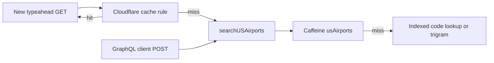

# Airport search edge cache

The KSBP lookup change did not touch [`MinioExternal`](mvn-backend/src/main/java/com/simplefbo/backend/external/MinioExternal.java). That class only stores uploaded files in object storage. There is no Redis in this project. Origin caching already uses in-memory Caffeine ([`CacheConfig`](mvn-backend/src/main/java/com/simplefbo/backend/config/CacheConfig.java), 10-minute write expiry). Airport search will use that memory cache, not MinIO.

Cloudflare cannot safely cache `POST https://api.dbslone.com/graphql`. That URL also carries reservations, invoices, and other per-user data, and Cloudflare does not cache POST bodies as the cache key. iOS and the web home-airport field both call `searchUSAirports` through that POST today ([`GraphQLClient`](simplefbo-ios/Sources/Core/Networking/GraphQLClient.swift), [`HomeAirport.tsx`](simplefbo-frontend/src/pages/FBOSettings/HomeAirport.tsx)).

The new GET does not change the GraphQL endpoint. `searchUSAirports` keeps the same arguments and the same `[UsAirport]` payload. The schema, the query document, and every other GraphQL operation stay as they are. The GET is another caller of that method.

Caching for the GraphQL client is the in-memory cache, not Cloudflare. `@Cacheable` goes on the shared search method, so a GraphQL POST and the GET store and read the same Caffeine entry. A repeat `searchUSAirports` from an older app build still skips Postgres. It just never hits the edge, because that request is still a POST to `/graphql`.

## Cacheable GET

Add `GET /api/airports/search?query=&limit=` that calls the existing [`UsAirportQuery.searchUSAirports`](mvn-backend/src/main/java/com/simplefbo/backend/query/UsAirportQuery.java). Response fields match the iOS `USAirport` model, with `id` as a string (GraphQL `ID` is a string; a raw Jackson `Long` would not decode).

- `Cache-Control: public, max-age=3600` on the GET only. GraphQL responses do not get this header, so Cloudflare still will not store them.
- Put `@Cacheable(value = "usAirports")` on a package-visible method that both the GraphQL resolver and the GET call after the query is trimmed and the limit is clamped to 5–25. Key on that normalized query and limit, so `ksbp` from GraphQL and `KSBP` from the GET share one entry. Return `List.copyOf` so neither caller can mutate the cached list. Skip blank queries. Unit tests construct the query directly, so also assert the annotation the same way invoice cache tests do.
- Add `/api/airports/search` to `PUBLIC_PATHS` in [`ClerkAuthFilter`](mvn-backend/src/main/java/com/simplefbo/backend/auth/ClerkAuthFilter.java). The directory is public OurAirports data. If the request required a Clerk token, Cloudflare could not share one response across pilots. Extend [`ClerkAuthFilterTest`](mvn-backend/src/test/java/com/simplefbo/backend/auth/ClerkAuthFilterTest.java).

## Callers

- iOS destination typeahead: `performAirportSearch` uses this GET instead of `searchUSAirports`. A test fails if KSBP still POSTs GraphQL.
- Web home airport: [`HomeAirport.tsx`](simplefbo-frontend/src/pages/FBOSettings/HomeAirport.tsx) uses the same GET. Update its test.
- Leave `searchUSAirports` in place. Older GraphQL builds keep working and use the Caffeine entry. New typeahead traffic uses the GET so it can also be served from Cloudflare.

## Gateway

[`virtualservice.yaml`](gateway-helm/charts/simplefbo-api-gateway/templates/virtualservice.yaml) only attaches CORS on listed prefixes. The catch-all route has none, so a browser call from the web app would fail preflight. Add a `/api/airports` match with the existing `istio.corsPolicy` include, ahead of the catch-all. iOS does not need CORS; the route still has to exist for the web app.

## Cloudflare rule

Use the `cf` CLI. Do not replace the zone ruleset. List the zone entrypoint for `http_request_cache_settings`, then append one rule with `cf rulesets account-rulesets rules create` on both `dbslone.com` (`api.dbslone.com`) and `simplefbo.com` (`api.simplefbo.com`):

- Expression: host is the API host, method is GET, path is `/api/airports/search`
- Cache eligible, edge TTL respects origin, 2xx cached, 4xx and 5xx not stored
- Cache key keeps the query string and does not vary on `Authorization` or cookies

`POST /graphql` stays uncached.
